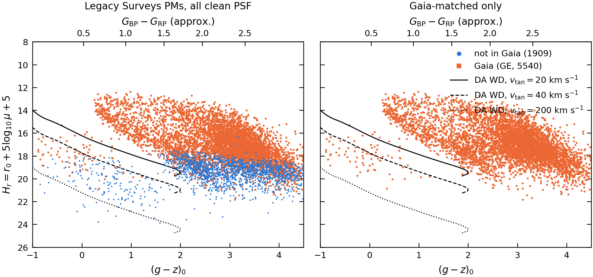
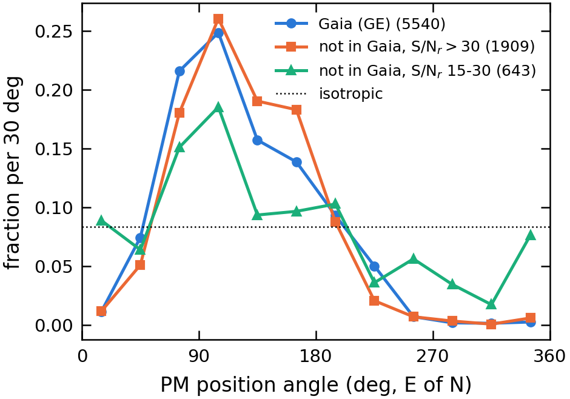
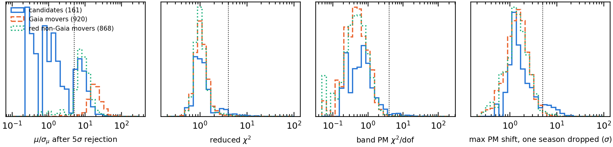
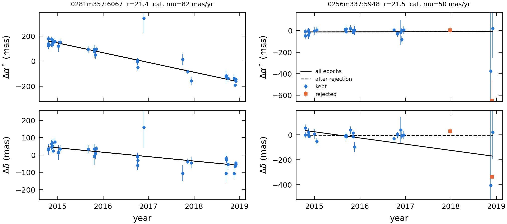
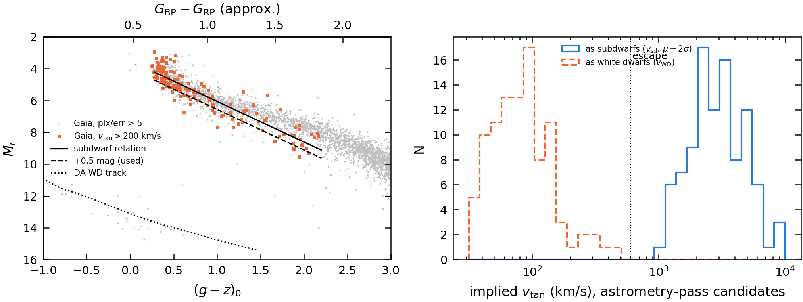
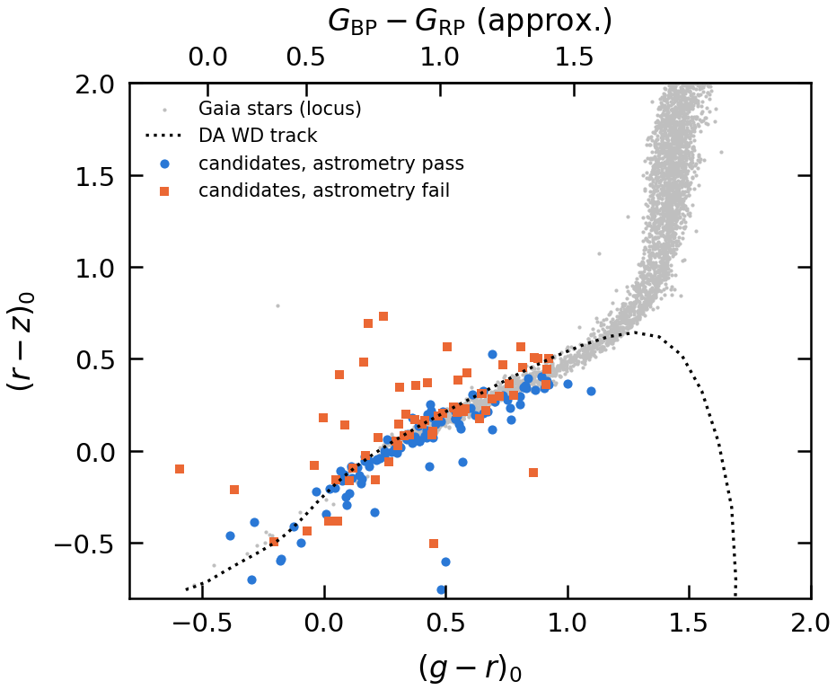

# Pilot application A: a reduced proper motion diagram beyond Gaia

*Nada El-Falou, 2026-10-27. Code: `application/rpm-diagram.ipynb` + `rpm.py` (the diagram) and `wd-vetting.ipynb` +
`wd_vet.py` + `wd_vet_extract.py` (vetting the white-dwarf candidates). Data: the v2 catalogue (`legacypm-catalogue-v2/`,
read-only) after the error-model v3 redo (per-epoch 2×2 errors, exposure–CCD zero points; slices 018–032 finished
2026-10-27 10:56). All numbers below are from that version. This is a pilot.*

*Update 2026-10-29: the faint limit is now **S/N_r > 30** instead of r < 23 (§3.4: r < 23 let noise into the candidate
list of a shallower field; S/N_r > 30 gives nearly the same sample in this field). Current numbers: 7,449 HPM (1,909 not
in Gaia), 161 non-Gaia WD candidates, 98 pass the astrometric tests (stacked parallax 2.65 ± 1.12 mas, prediction 2.67),
grades A 92 / B 6 / X 63; held-out field B: 83 non-Gaia candidates, 81 ± 12% real by the direction test. The sections
below still quote the r < 23 numbers (within a few per cent of these), except §3.4. A short version is in the paper:
`writeup/main.tex` sec:application, figure from `run/rpm-diagram.ipynb`. Eleven candidates that are new under the S/N cut
have not been inspected by eye, so they have no `IMAGE_FLAG` entries.*

## Summary

- A reduced proper motion (RPM) diagram from 200 bricks (12.5 deg² at b ≈ −75°) shows what the catalogue adds:
  **high proper motion (HPM) stars not in Gaia extend the M-dwarf sequence 2–3 mag fainter in H_r than Gaia reaches**,
  and **157 non-Gaia objects fall in the white-dwarf region**, which Gaia barely populates in the same field.
- **Vetting the 157 white-dwarf candidates: 89 survive as strong candidates (grade A), 7 more have good motions but
  blended images (grade B), and 61 are rejected** because their motion is not robust. The tests are calibrated on real
  movers at the same magnitude, which pass 90% of the time.
- Three independent checks agree that the survivors are real, nearby white dwarfs:
  - **Motion direction:** 90% of them move in the solar-reflex direction, like real stars in this field (random noise:
    50%).
  - **Parallax:** stacked, the grade A parallax is 3.3 ± 1.2 mas; white dwarfs at these magnitudes predict 2.7 mas, and
    halo stars would give ~0.
  - **Not subdwarfs:** as main-sequence stars they would need tangential velocities above 600 km/s (beyond the escape
    speed) even with the PM lowered by 2σ; a third of them are also bluer than any old main-sequence star.
- **Two catalogue issues** turned up along the way:
  1. **PM errors are underestimated for faint objects** (×1.2–1.3 at r 23–24, ×1.7 at r 24–25, ×2.2 at r > 25, heavy
     tails), still true with error model v3, and `pm_quality == 0` does not flag low S/N. A 4σ HPM selection without a
     magnitude limit returns 43,000 objects in 200 bricks, 83% of them noise. HPM objects at r ≥ 23 are mostly noise.
  2. **Parallax errors for Gaia stars are now underestimated by ~20%** (pull width 1.22 with v3, 0.96 with the old model).

## 1. Motivation

**Absolute magnitudes without distances.** A colour–magnitude diagram needs distances. Our parallaxes are weak (fields
tend to be observed at the same time of year), and Gaia parallaxes stop at G ≈ 21. Proper motion can stand in for
distance, because nearer stars tend to move faster on the sky. From m − M = 5 log₁₀ d − 5 and v_tan = 4.74 μ d
(μ in arcsec/yr, d in pc):

> **H = m + 5 log₁₀ μ + 5 = M + 5 log₁₀ (v_tan / 4.74 km s⁻¹)**

The reduced proper motion H needs only the apparent magnitude and the PM. It is the absolute magnitude plus a term that
depends only on tangential velocity, so for a population with similar velocities H is a blurred, shifted version of M:

| population | typical v_tan | where it sits in H vs colour |
|---|---|---|
| disc main-sequence stars | 20–50 km/s | upper sequence |
| halo subdwarfs | 200–300 km/s | ~5 mag lower in H at the same colour (10× the velocity) |
| white dwarfs (disc) | 20–40 km/s | 5–7 mag below the main sequence (much fainter M) |
| white dwarfs (halo) | ~200 km/s | a further ~3.5 mag lower |

This is the classic way to find white dwarfs and halo stars without parallaxes (Luyten; Jones 1972; later with SDSS,
Pan-STARRS and Gaia).

**Why our catalogue matters here.** At a given μ, the depth of the diagram in H is set by the survey's magnitude limit.
We measure PMs reliably to r ≈ 23 (§3.3) compared with Gaia's ~21, so at every μ our diagram reaches ~2 mag deeper in H,
into the region of cool white dwarfs, faint M dwarfs and distant halo stars.

## 2. Method (the diagram)

**Field.** 200 bricks drawn at random (fixed seed) from the 1,310 v2 bricks with centres in RA 25–35°, Dec −40 to −30°
(b ≈ −70 to −80°: low extinction and crowding, a relatively large halo fraction). 2,031,131 sources, of which 589,775 are
clean, primary point sources.

**Quantities.** Magnitudes g, r, z from the Tractor fluxes, corrected for Galactic extinction (`mw_transmission_*`);
colour (g − z)₀. μ = √(pmra_no_plx² + pmdec_no_plx²) from the 4-parameter fit (absolute for all objects: for Gaia stars the
pipeline adds the Gaia motion back). σ_μ = √(1/ivar_ra + 1/ivar_dec): this combines the two per-axis errors and is about
√2 larger than the true error on μ, so "μ/σ_μ > 4" is roughly a 5.7σ detection of motion. H_r = r₀ + 5 log₁₀(μ/1000 mas) + 5.

**Selection.** `brick_primary`; `type == 'PSF'`; `pm_quality == 0`; g, r, z all measured; μ > 20 mas/yr; μ/σ_μ > 4, which
keeps the error on H below ~0.5 mag (σ_H ≈ 2.17 σ_μ/μ); and **r₀ < 23** (§3.3). Gaia stars are `ref_cat == 'GE'`.

**White-dwarf tracks.** Montreal cooling models (Bergeron et al. 1995; Bédard et al. 2020), 0.6 M☉, pure-hydrogen (DA)
atmospheres, from astro.umontreal.ca/~bergeron/CoolingModels/ (`application/data/`). Each model gives M_r and g − z along
the cooling sequence, converted with H_r = M_r + 5 log₁₀ v_tan − 3.38 for **v_tan = 20 and 40 km/s** (disc) and
**200 km/s** (halo). The models use SDSS g, r, z rather than DECam filters (a few hundredths of a magnitude). The hook at
g − z ≈ 2 is physical: below ~4,500 K, hydrogen-atmosphere white dwarfs turn bluer again (collision-induced absorption by
H₂).

**Second colour axis.** Every plot with a colour on the x-axis has Gaia BP − RP along the top, as an approximate
translation for readers used to Gaia colours. For g − z it uses the pipeline's own relations (`rpm.gz_bprp_table`):
g − i from g − z with the cubic in `py_files/colour_fallback.json`, then the DCR reference-colour relation
g − i = −0.56 + 1.34 (BP − RP), inverted: g − z = −1, 0, 1, 2, 3, 4 → BP − RP ≈ 0.04, 0.48, 1.07, 1.72, 2.33, 2.82. The cubic
is fitted for −0.12 < g − z < 3.97 and extrapolated outside it. A median fit to the Gaia stars in these bricks agrees
within ~0.05 mag at 0 < g − z < 3, but differs at the blue end, where only white dwarfs live (BP − RP −0.25 vs 0.04 at
g − z = −1), so read the top axis there as indicative. g − r (colour–colour plot) has no pipeline relation; there the top axis is the
median dereddened BP − RP of the clean Gaia stars in g − r bins (DA track bluer than the stars), with ticks only up to
BP − RP 1.5 because g − r saturates for M dwarfs. Both tables are saved by `rpm-diagram.ipynb` to `output/bprp_relation.npz`.

**White-dwarf candidates.** g − z < 1.5 and no more than 1.5 mag brighter in H_r than the 40 km/s track: too faint for
their colour to be disc main-sequence stars.

## 3. Results (the diagram)

### 3.1 The diagram



*H_r vs (g − z)₀ for clean HPM point sources in 200 bricks. Left: all objects (blue: not in Gaia; orange: Gaia).
Right: Gaia-matched only. Black lines: DA white-dwarf cooling track at v_tan = 20 (solid), 40 (dashed) and 200 km/s
(dotted).*

| r₀ | HPM objects | of which in Gaia | median σ_μ (mas/yr) |
|---|---|---|---|
| 14–19 | 2,063 | 2,063 | 1.3 |
| 19–21 | 2,754 | 2,748 | 1.7 |
| 21–22 | 1,479 | 703 | 2.8 |
| 22–23 | 1,142 | 27 | 4.2 |
| **total** | **7,438** | **5,541** | |

With μ > 15 mas/yr instead: 11,633 objects (8,740 Gaia, 2,893 not).

- **Gaia stars** form the expected structure: disc M dwarfs at g − z ≈ 3–4, H_r ≈ 16–19, and a bluer, kinematically
  hotter (thick disc / halo) sequence at g − z ≈ 0.3–2, H_r ≈ 13–17. The Gaia-only panel stops at H_r ≈ 21.
- **Non-Gaia stars continue the red sequence** about 2–3 mag fainter (H_r ≈ 18–22): fainter, more distant M dwarfs and
  subdwarfs.
- **The white-dwarf region fills in.** 231 objects pass the white-dwarf cut, 74 in Gaia and **157 not**; most of the
  non-Gaia ones lie between the 40 and 200 km/s tracks, where the Gaia-only panel has only a sprinkling of objects.

### 3.2 Which HPM objects are real? The PM-direction test

The Sun moves through the Galaxy, so real stars show a reflex motion: in a given field their PM directions cluster.
Noise has no preferred direction. This test does not depend on the error model.



*Distribution of PM position angle (east of north) for three groups of HPM objects. Dotted line: random directions.*

| group | N | max/min bin ratio | fraction at μ/σ_μ 4–5 | median μ (mas/yr) | median g − z |
|---|---|---|---|---|---|
| Gaia stars | 5,541 | 197 | 0% | 28.8 | 2.98 |
| not in Gaia, r₀ 21–23 | 1,897 | 492 | 17% | 27.3 | 2.97 |
| not in Gaia, r₀ 23–24 | 987 | 6.6 | 41% | 84.3 | 1.59 |

- Non-Gaia stars at r 21–23 have the **same direction distribution as the Gaia stars** (peak ~100° E of N): real movers.
- Objects at r 23–24 are **close to random**, pile up just above the cut, and have implausibly large PMs: mostly noise,
  with some real stars mixed in. Their colour (g − z ≈ 1.6, bluer than the M dwarfs) is closer to the faint galaxy and
  quasar population. On the diagram they formed a blob at H_r ≈ 23–26 lying on the 200 km/s track, which would be
  misread as a population of halo white dwarfs. Hence **r < 23**.

### 3.3 A catalogue issue: underestimated PM errors at the faint end

Faint point sources not in Gaia are mostly unresolved galaxies and quasars, with true PM ≈ 0, so their PMs test the
errors directly. With correct Gaussian errors the pull (PM/σ) has width 1, and 0.03% exceed χ² = 16 (4σ in 2-D).

| r₀ | N | beyond χ² = 16 | pull width (RA) | median σ_μ (mas/yr) | median S/N in r |
|---|---|---|---|---|---|
| 21–22 | 8,504 | 35.7% | 2.21 | 3.6 | 99 |
| 22–23 | 16,879 | 18.4% | 1.61 | 7.5 | 45 |
| 23–23.5 | 15,396 | 6.1% | 1.24 | 15.1 | 24 |
| 23.5–24 | 35,523 | 5.3% | 1.28 | 23.9 | 15 |
| 24–25 | 271,976 | 14.7% | 1.74 | 42.8 | 7 |
| > 25 | 198,853 | 25.4% | 2.22 | 50.9 | 4 |

(200 bricks, error model v3. Pull width = 1.4826 × median absolute deviation.)

- At r < 23 the rates are mostly real stellar motions mixed into the sample, so those rows do not test the errors.
- At r > 23 the sample is dominated by zero-PM objects: **errors too small by ×1.2–1.3 at r 23–24, ×1.7 at r 24–25 and
  ×2.2 at r > 25**, with tails far heavier than Gaussian. Error model v3 did not change this (old model: 1.22–1.27, 1.73,
  2.22).
- `pm_quality == 0` has no low-S/N bit, so these objects count as clean. Without a magnitude limit, a μ > 20 mas/yr, 4σ
  selection gives 43,403 "HPM" objects in these 200 bricks; only 7,438 survive r < 23.

This matches the H3 finding that the statistical errors of faint stars are underestimated. Options: a faint-end term in
the error model, or a low-S/N bit in `pm_quality`. Users need a magnitude or S/N limit for any faint HPM selection.

### 3.4 Held-out field: are the numbers specific to this patch of sky?

`R_MAX` and the white-dwarf cut were chosen on field A (above). I reran the diagram unchanged on 200 bricks of a
held-out **field B: RA 5–15, Dec −20 to −10**, about 25° away with no shared bricks and at the same Galactic latitude
(b ≈ −76° vs −78°). Run it with `RPM_FIELD=B` (outputs `*_fieldB*`; executed copy `rpm-diagram-fieldB.ipynb`).

**The two fields differ in depth, not in stars.** They have the same number of Gaia stars (19.8k vs 20.1k at G < 20), so
the same stellar density. But field A has DES-like coverage and field B DECaLS-like:

| | field A | field B |
|---|---|---|
| epochs per object (median) | 32 | 14 |
| exposures per band | 7–9 | 3–4 |
| baseline | 4.2 yr | 5.1 yr |
| clean fraction (Gaia) | 0.83 | 0.74 (`FEW_EPOCHS` 13%) |
| σ_μ of PSF objects, r 22–23 | 7.5 mas/yr | 14.7 mas/yr |

So B is a harder test than intended: the same cuts on half as many epochs.

| | field A | field B |
|---|---|---|
| sources / clean primary PSF | 2.03M / 590k | 1.28M / 350k |
| HPM (μ > 20, r < 23): Gaia / not | 5,541 / 1,897 | 4,149 / 1,227 |
| HPM without the r limit | 43,403 | 14,730 |
| WD candidates: Gaia / not | 74 / 157 (12.6 deg⁻²) | 45 / 119 (9.5 deg⁻²) |
| faint pull width, r 23–23.5 / 23.5–24 / 24–25 / > 25 | 1.24 / 1.28 / 1.74 / 2.22 | 1.15 / 1.24 / 1.51 / 1.92 |

Direction test, giving the share of each group within 90° of the Gaia stars' mean direction, and the real fraction
implied by comparing it with Gaia:

| group | field A | field B |
|---|---|---|
| non-Gaia, r 21–22 | 0.97 (all real) | 0.98 (all real) |
| non-Gaia, r 22–23 | 0.93 (all real) | 0.90 (~88% real) |
| non-Gaia, r 23–24 (excluded) | isotropic (max/min bin 6.6) | isotropic (2.2) |
| non-Gaia WD candidates, all | 0.81 vs 0.78 for Gaia WD candidates: consistent with all real | 0.72 vs 0.87: ~60 ± 10% real |
| — μ/σ > 6 | 0.88 | 0.81 (~85% real) |
| — μ/σ 4–6 | 0.74 (~85% real) | 0.65 (~40% real) |
| — r < 22 | 0.85 | 0.91 (all real) |

**What carries over:**
- The diagram's structure: the faint red-sequence extension and the white-dwarf locus appear in both fields.
- r 21–23 holds mostly real movers in both fields, and r 23–24 is noise in both.
- Faint-end PM errors are underestimated in both, growing with magnitude. At equal S/N the effect is somewhat
  smaller in B.
- The fraction of HPM objects that are WD candidates is similar: non-Gaia 8.3% (A) vs 9.7% (B); Gaia 1.3% vs 1.1%.

**What does not:**
- **Purity of the white-dwarf list at 4–6σ.** Field B's non-Gaia candidates are only ~60% real by the direction test,
  against all of them in A. The marginal 4–6σ ones are the problem (~40% real). In shallower data, fewer real faint
  movers pass 4σ while the noise tail stays, so the noise share rises.
- **The r < 23 limit is really a depth limit.** Field B at r 22–23 has the same median S/N_r (23) as field A at
  r 23–23.5, and both are where the direction signal weakens. A limit in S/N (or σ_μ) rather than r would transfer
  between survey depths.
- **Candidate density depends on depth.** 12.6 vs 9.5 deg⁻² before vetting. An area extrapolation (§6) has to be done
  per depth.

The vetting (§4) has not yet been run on field B. It is the step that should restore the purity: in field A it removed
mostly the marginal objects.

## 4. Vetting the 157 non-Gaia white-dwarf candidates

### 4.1 What could fake a candidate?

**Not halo subdwarfs.** The candidate region lies 6–7 mag below the main sequence in H_r. A subdwarf moving at 300 km/s
sits ~4–5 mag above it; to land inside, a main-sequence star would need v_tan ≳ 600 km/s, above the local escape speed
(~550 km/s). (An earlier draft of this note wrongly said subdwarfs and white dwarfs are degenerate in this diagram.)

**Spurious PMs.** This is the real contaminant: a PM overestimated by noise moves an object down in H_r. Since ~5% of
zero-PM faint objects pass a 4σ cut (§3.3), the large number of faint objects can supply dozens of fake candidates.

### 4.2 Tests

Per-epoch data for the 157 candidates (5,292 measured epochs in 108 bricks) were extracted from the corrected forced
files (`wd_vet_extract.py`, 20 s on a compute node) and refit with the pipeline's own fitting function on the same inputs
(zero-point-corrected positions, total errors with the RA–Dec correlation). The refit reproduces the catalogue PMs
exactly. Then:

1. **Astrometric robustness** (five tests, each must pass):
   - significance after iterative 5σ epoch rejection: μ/σ_μ > 5 (proper error propagation);
   - μ changes by less than 30% under that rejection;
   - reduced χ² of the fit < 4;
   - PMs fitted separately per band (≥ 5 epochs over ≥ 2 yr) agree: χ²/dof < 4;
   - dropping any one calendar year moves the PM by < 5σ.

   Calibration on real movers in the same bricks: clean Gaia stars with μ > 20 mas/yr and r > 20 (915 stars, median
   r 20.6), and, at the candidates' magnitudes, non-Gaia HPM stars on the red sequence (g − z > 2, r 21–23; 856 stars,
   median r 22.1), which the direction test shows are real.
2. **Stacked parallax.** At their magnitudes and colours, white dwarfs would be ~250–700 pc away (parallax 1.5–4 mas); halo
   subdwarfs several kpc (~0.1–0.3 mas). Individual parallaxes (`parallax_new`, σ ≈ 13 mas) are useless; the weighted mean
   of ~90 is not. Zero point from a control sample at the same magnitudes with no significant PM (distant stars and
   quasars, true parallax ≈ 0), checked against the Gaia stars.
3. **Subdwarf velocity.** M_r(g − z) for high-velocity stars from 149 Gaia stars in these bricks with v_tan > 200 km/s and
   parallax/error > 5: M_r = 3.49 + 2.54 (g − z), scatter 0.59 mag. For each candidate, the tangential velocity it would
   need as such a star, conservatively: relation shifted 0.5 mag fainter, μ lowered by 2σ, objects bluer than the halo
   turnoff (g − z = 0.28) given the turnoff value.
4. **Colours and images.** g − r vs r − z against the stellar locus and the white-dwarf track; WISE W1; Legacy Survey
   image and model-residual cutouts of every candidate, inspected by eye for blends and artefacts.

### 4.3 Results

**Astrometric tests**

| test | candidates | Gaia movers (r ~ 20.6) | red non-Gaia movers (r ~ 22.1) |
|---|---|---|---|
| significant after 5σ rejection | 115/157 (73%) | 100% | 98% |
| μ stable under rejection | 116/157 (74%) | 100% | 97% |
| reduced χ² < 4 | 124/157 (79%) | 96% | 95% |
| bands agree | 120/157 (76%) | 98% | 97% |
| season jackknife | 104/157 (66%) | 97% | 93% |
| **all five** | **96/157 (61%)** | **94%** | **90%** |



*Distributions of four test statistics for the candidates and the two real-mover samples; dotted lines are the
thresholds.*

If all 157 candidates were real movers, ~15 would fail; 61 fail. The failures typically owe their "motion" to one or two
discrepant epochs:



*Left: a passing candidate, a clean linear motion over four years. Right: a rejected one; one late epoch carries the whole
"motion", and without it the PM is ~0.*

Many rejected candidates sit inside bright galaxies or their halos in the cutouts (`plots/wdvet_cutouts.png`).

**Independent check of the tests (PM directions).** The 96 candidates that pass move in the reflex half of position angles
(45–225°) 90% of the time, the same as real movers in this region (~91%), which implies essentially all are real. Only 62%
of the 61 failures do, implying ~30% (~18) real movers among them, close to the ~15 expected from the real-mover failure
rate. The tests remove noise, not real stars.

**Stacked parallax**

| sample | N | stacked parallax (mas) | white-dwarf prediction (mas) |
|---|---|---|---|
| Gaia stars: ours − Gaia | 12,384 | +0.13 ± 0.03 | – |
| control (true ≈ 0) | 5,608 | −0.11 ± 0.17 | 0 |
| candidates passing the astrometric tests | 96 | +2.76 ± 1.13 | 2.68 |
| grade A | 89 | **+3.26 ± 1.17** | 2.66 |
| candidates failing | 61 | −1.17 ± 1.70 | 2.47 |

(Candidates: zero-point corrected with the control sample; errors scaled by the control pull width, 1.10.) The survivors
are ~2.8σ from zero parallax and agree with the white-dwarf prediction; halo stars would give ~0.2 mas. The rejected
objects are consistent with zero. *Note:* the Gaia-star parallax pull width is 1.22 with error model v3 (0.96 with the old
model): our parallax errors are underestimated by ~20% for these stars.

**Subdwarf test**



*Left: M_r vs g − z for Gaia stars with good parallaxes (grey), the high-velocity ones (orange), the subdwarf relation
(solid), the conservative version used (dashed), and the white-dwarf track (dotted). Right: tangential velocities the
passing candidates would need as subdwarfs (solid) and have as white dwarfs (dashed).*

All 96 passing candidates would need v_tan > 600 km/s as main-sequence stars, even with μ − 2σ; 34 are also bluer than the
halo turnoff. As white dwarfs their velocities are 43 / 79 / 137 km/s (10th / 50th / 90th percentile): typical of the thin
and thick disc, with a tail towards the halo.

**Colours and images**



*g − r vs r − z: stellar locus (grey), DA track (dotted), candidates passing (blue) and failing (orange).*

The passing candidates lie tightly on the locus and the white-dwarf track; the failures scatter off it (noisy photometry,
galaxy light). For g − r < 1 the white-dwarf track runs along the main-sequence locus, so these colours only separate the
bluest objects. 32 of 157 are detected in WISE W1 (S/N > 3); most are too faint for WISE, as expected. Image inspection
flagged 9 candidates: 3 blended with or inside a galaxy, 6 next to or touching a brighter star. Two of these fail the
astrometric tests anyway.

### 4.4 Grades (`output/wd_candidates_vetted.{fits,csv}`)

| grade | meaning | N |
|---|---|---|
| **A** | passes all astrometric tests, clean image, would need > 600 km/s as a subdwarf (or bluer than the turnoff) | **89** |
| **B** | passes the astrometric tests, but the image shows a blend or a bright neighbour | 7 |
| **X** | motion not robust (fails at least one astrometric test) | 61 |

Grade A objects: r 21.05–22.98 (median 21.9), g − z −1.0 to 1.4 (median 0.5), μ 21–147 mas/yr (median 39), H_r 18.1–22.8;
μ/σ_μ after epoch rejection 5.3–40 (57 above 8). Over the 12.5 deg² sampled, that is ~7 per deg² of white-dwarf
candidates that Gaia does not have.

## 5. What is solid and what is not

**Solid**
- The diagram's main message: the faint extension of the red sequence beyond Gaia is real (direction test).
- The white-dwarf region: after vetting, 89 strong non-Gaia candidates whose motions pass five astrometric tests, move like
  real stars, and have a stacked parallax consistent with white dwarfs and ~2.8σ from zero.
- Two catalogue findings: faint-end PM errors underestimated (§3.3); Gaia-star parallax errors underestimated by ~20% in v3.

**Not yet established**
- **Individual objects.** Each grade A object is a candidate; the evidence for white-dwarf nature is statistical (stack,
  directions). A few may still be spurious. Spectroscopy would settle individual cases; DESI may already have spectra for
  some.
- **Completeness.** ~18 real movers are among the rejected objects; the tests trade completeness for purity.
- **Thresholds.** Chosen by hand from the real-mover distributions, not optimised. On a held-out field at DECaLS depth
  (§3.4) the diagram carries over but the unvetted candidate list is only ~60% real.
- **r 23–24.** Real stars are there, but they cannot be separated from noise with the current errors.
- **Model simplifications.** One white-dwarf mass (0.6 M☉) and atmosphere (DA); SDSS rather than DECam filters.

## 6. Next steps

1. Cross-match grade A with DESI spectra and existing white-dwarf catalogues (Gentile Fusillo et al. 2021 is Gaia-based,
   so overlap with non-Gaia objects should be small; any overlap tests the method).
2. Decide on the faint-end PM error issue and the v3 parallax pull width for the catalogue, before the paper is submitted.
3. If the diagram goes into the paper's applications section, move the notebooks into `run/` so the figures are saved to
   `writeup/plots/` (project rule). The held-out field (§3.4) says to replace `R_MAX` with an S/N or σ_μ limit and to
   vet field B before quoting a candidate density.
4. Larger area: the footprint has ~5,000 deg² at similar latitudes; at ~7 per deg² that would be of order 30,000
   candidates (a rough extrapolation, not a measurement: density varies with latitude and depth).

## Reproducing

```
cd application
# the diagram (200 bricks, ~13 min of file reading) and the candidate extraction (20 s)
srun -A desi -q interactive -C cpu -N 1 -t 00:45:00 bash -c "jupyter nbconvert --to notebook --execute --inplace \
    --ExecutePreprocessor.kernel_name=desi-pm rpm-diagram.ipynb && python wd_vet_extract.py"
# the vetting (login node is fine; downloads cutouts from legacysurvey.org once)
jupyter nbconvert --to notebook --execute --inplace --ExecutePreprocessor.kernel_name=desi-pm wd-vetting.ipynb
```

Diagram parameters at the top of `rpm-diagram.ipynb`: `N_BRICKS` (200), `MU_MIN` (20 mas/yr), `SNR_MIN` (4), `R_MAX` (23),
`SEED` (1). Vetting thresholds: `THRESH` in `wd-vetting.ipynb`; image flags: `IMAGE_FLAG` (keyed by brick:objid).
`wd_vet_extract.py` refuses bricks that are not on error model v3.
